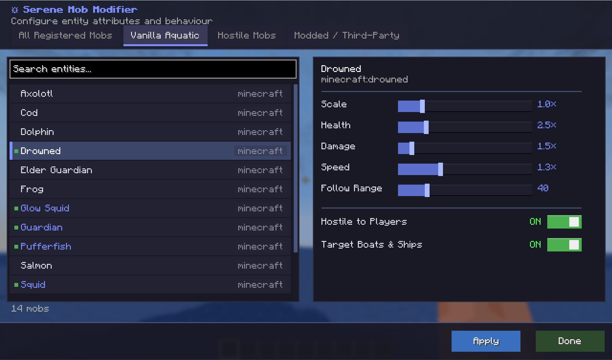
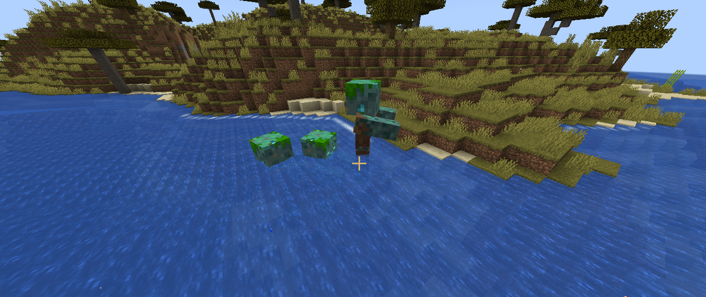
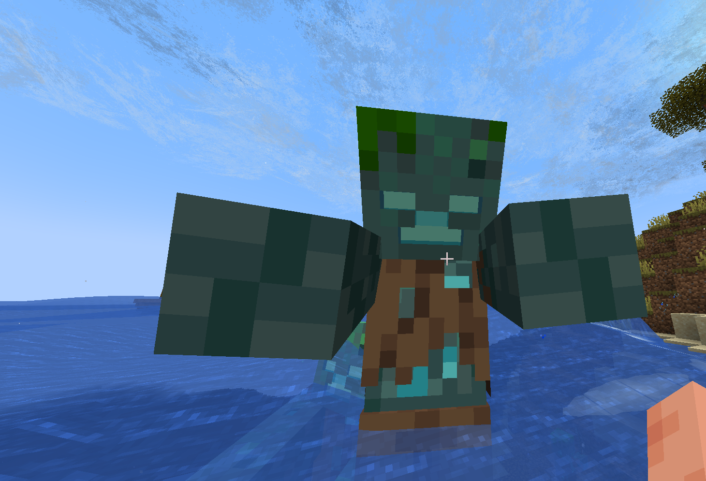
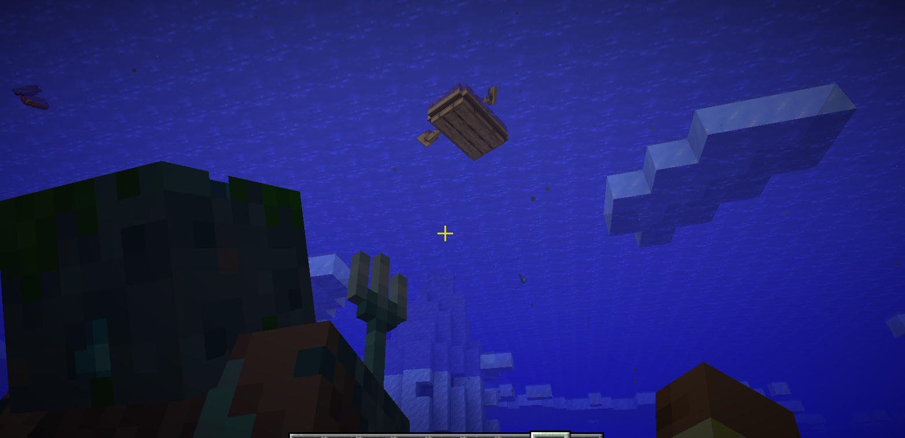

# Serene Mob Modifier

  

Serene Mob Modifier lets you customize mob sizes, stats, and aggression in Minecraft. Scale mobs into giant bosses or tiny creatures, tweak their health and attack power, and make them target players in boats and ships.

---

## Features

- **Custom Mob Sizes**: Scale vanilla and modded mobs up or down.
- **Adjustable Stats**: Modify health, attack damage, movement speed, and follow distance.
- **Custom Aggression**: Turn passive or neutral mobs into hostile threats.
- **Boat and Ship Hunting**: Enable mobs to pursue players in vanilla boats, intercept moving vessels, and climb ladders to board ships.
- **In-Game Editor**: Adjust and save entity rules live without restarting your game.

---

## In-Game Menu

Press **M** while playing to open the configuration screen.

From this screen, you can search for entities, change multipliers, and toggle behaviors.

---

## Screenshots

### Scaled Mobs
Make mobs larger or smaller to create custom challenges and unique encounters.

### Boat and Ship Boarding
Mobs can hunt players on water and board assembled vessels.

---

## How to Use

1. Press **M** to open the Mob Modifier menu (the keybind can be changed in your Controls settings).
2. Select the mob you want to customize.
3. Adjust attributes such as scale, health, damage, speed, and follow range.
4. Toggle hostility and boat-targeting behavior.
5. Save your changes to apply them immediately to newly spawned mobs.

